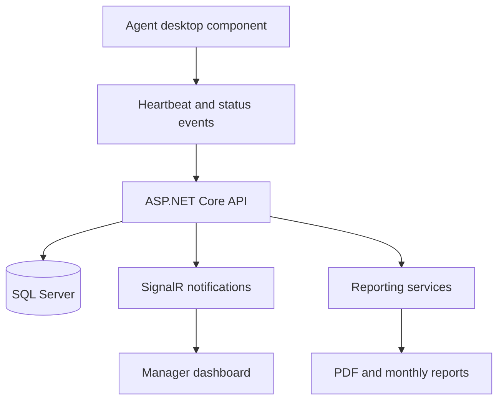

# AgentSync — Call-Center Monitoring & Operations

**Category:** Business software · Real-time monitoring · Reporting  
**Stack:** C#, ASP.NET Core, SQL Server, Entity Framework Core, SignalR, WPF

## Problem

Call-center managers need a reliable view of agent attendance, availability, activity, and operational reporting without depending entirely on manual status updates.

## Product scope

AgentSync is a monitoring and operations product concept built around:

- Agent attendance and arrival-time tracking.
- Online, idle, and offline status visibility.
- Live monitoring signals and screenshot workflows.
- Duty counts and sales history.
- Salary/hour summaries and PDF/monthly reporting.

## High-level architecture

## Engineering considerations

- **Presence and freshness:** distinguish a current agent heartbeat from stale state.
- **Real-time updates:** use event delivery to update manager views without relying only on manual refresh.
- **Operational reporting:** keep attendance and work summaries consistent with stored records.
- **Privacy and access:** protect monitoring data, screenshots, and employee records with appropriate authorization and retention controls.
- **Resilience:** ensure temporary client disconnections do not permanently leave an agent in an incorrect state.

## What this demonstrates

Real-time application design, desktop-to-API communication, backend services, database-backed reporting, and the operational concerns of a business monitoring product.

## Code and demonstration

AgentSync contains proprietary product work. This public write-up intentionally excludes source code, live customer data, credentials, and screenshots of private systems.
