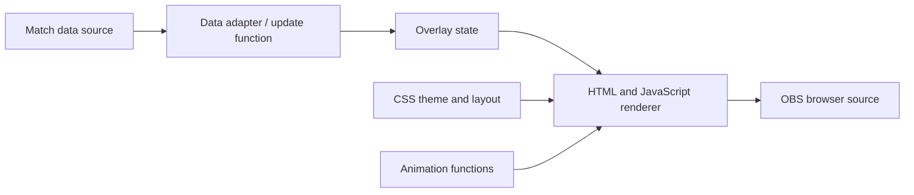

# Esports Overlay & Tournament Graphics

**Category:** Esports tooling · Live graphics · Frontend engineering  
**Stack:** HTML, CSS, JavaScript, API integration, OBS browser overlays

## Goal

Create configurable broadcast graphics that present tournament information clearly while remaining suitable for use as transparent browser overlays in OBS.

## Product direction

The work includes esports web experiences and an overlay workflow focused on team standings and live tournament statistics. The overlay design direction includes:

- Transparent 16:9 browser overlays that fit an OBS scene.
- Team cards and standings with values such as team name, points, eliminations, alive-player count, and health.
- Live data updates through a defined JavaScript update function and API-backed data flow.
- Visual states for eliminated teams, low health, and blue-zone status.
- A final-five presentation for late-game tournament moments.
- A separation between reusable theme styling and overlay-specific animation behavior.

## High-level architecture

## Engineering considerations

- **Rendering stability:** update existing UI state predictably rather than rebuilding unnecessarily.
- **Data correctness:** keep point calculations and sorting rules consistent with the source data.
- **Broadcast readability:** optimize typography, contrast, and spacing for a 1920×1080 scene.
- **Separation of concerns:** keep data/rendering logic distinct from CSS styling and animation behavior.
- **Editor/runtime parity:** ensure an overlay preview uses the same dimensions and behavior as the browser source in OBS.

## What this demonstrates

Frontend architecture, live-data rendering, animation integration, visual system design, and translating esports broadcast needs into configurable software.

## Status and access

This is an evolving project area. Features described here represent the intended and developed workflow, not a claim that every capability is deployed in a production tournament. Proprietary implementation details are not published.
