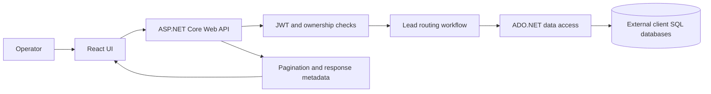

# LeadPlatform — Lead Distribution & Routing

**Category:** Backend platform · API integration · Multi-tenant data workflows  
**Stack:** C#, ASP.NET Core Web API, SQL Server, ADO.NET, React, Axios, JWT

## Problem

Lead-routing systems often need to connect an application to databases owned or managed by different clients. The integration challenge is to normalize access to varied data structures while keeping requests scoped, predictable, and observable.

## Engineering approach

- Build API-driven workflows in ASP.NET Core.
- Access external SQL Server databases using ADO.NET and schema-aware data handling.
- Use pagination to avoid returning unbounded result sets.
- Use JWT-based authentication and tenant/ownership checks to scope access.
- Provide a React-based interface for operational workflows and data views.
- Treat rate limiting and anomaly/ownership checks as part of the API boundary.

## High-level architecture

## Key considerations

- **Tenant isolation:** verify that a request is authorized for the requested client data.
- **Schema variation:** inspect external schemas rather than assuming every customer database is identical.
- **Performance:** paginate data and avoid unnecessarily broad queries.
- **Reliability:** validate inputs and handle database or integration failures at the API boundary.
- **Security:** never expose connection strings, credentials, or customer records in a public portfolio.

## What this demonstrates

API design, SQL Server integration, backend workflow modeling, multi-tenant security considerations, and connecting a React interface to backend services.

## Code and demonstration

The implementation is maintained in a private repository. This case study describes the system at a high level; it does not publish source code or customer-specific details.
