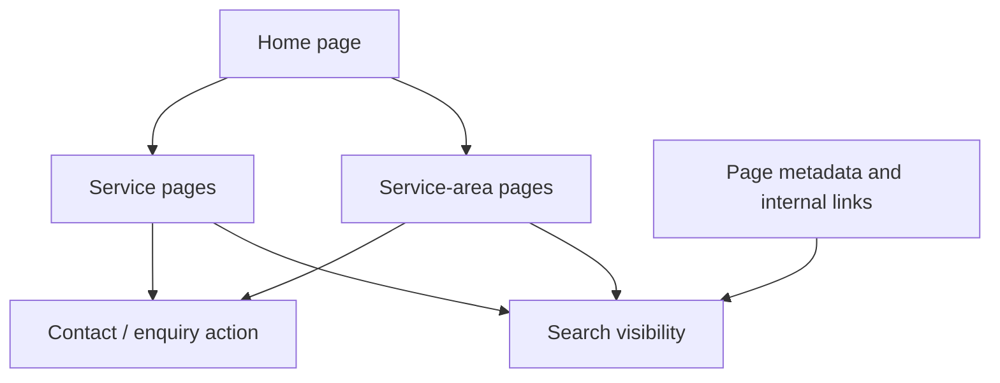

# MoovDubai — Moving Services Website

**Category:** Business website · Local SEO · Responsive frontend  
**Stack:** HTML, CSS, JavaScript, responsive web design, local-search content structure

## Goal

Present moving and packing services in a clear, trustworthy way and help visitors find the relevant service and service area quickly.

## Work focus

- Organize service pages around moving, packing, and related customer needs.
- Structure location-specific content for service areas in the UAE.
- Keep calls to action and service information easy to find on mobile and desktop.
- Consider page performance, crawlability, sitemap coverage, and search-console feedback.
- Use locally relevant visual direction and service descriptions rather than generic template copy.

## High-level page structure

## Engineering considerations

- **Information architecture:** help users navigate from a service need to a relevant page.
- **Local relevance:** make service-area content useful and specific rather than duplicative.
- **Responsive behavior:** keep content and contact actions usable on smaller screens.
- **Technical SEO:** review metadata, internal links, sitemap, and indexing signals.
- **Performance:** minimize unnecessary assets and monitor page loading behavior.

## What this demonstrates

Practical frontend development, business-oriented UX, local SEO structure, and attention to website maintainability and discoverability.

## Project link

The source repository is private. A public case study is provided here without exposing source code or deployment configuration.
